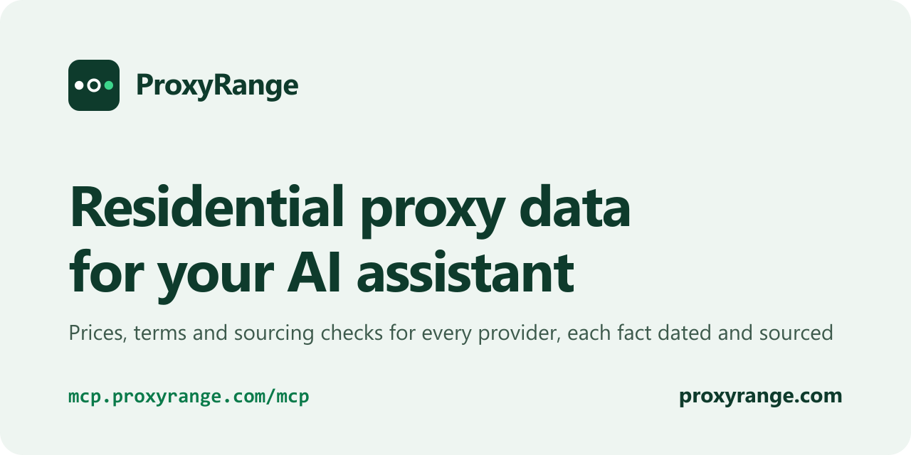

<p align="center">
  <a href="https://proxyrange.com/mcp">
    <picture>
      <source media="(prefers-color-scheme: dark)" srcset="assets/banner-dark.png">
      
    </picture>
  </a>
</p>

<p align="center">
  <a href="https://proxyrange.com"><b>proxyrange.com</b></a> ·
  <a href="https://proxyrange.com/mcp">Setup</a> ·
  <a href="https://proxyrange.com/residential-proxy-comparison">Compare providers</a> ·
  <a href="https://proxyrange.com/data">Open data</a> ·
  <a href="https://proxyrange.com/method">How we work</a>
</p>

# ProxyRange MCP server

Ask your AI assistant about residential proxies and it answers from our dated prices, terms and sourcing checks for 30 providers, linking the page each fact comes from. Free, read-only, no sign-in or API key.

Every answer comes from [proxyrange.com](https://proxyrange.com): checkout prices for 1, 10 and 100 GB, terms, and a sourcing check for each provider, each fact with the date it was checked and its source.

**Server URL**

```
https://mcp.proxyrange.com/mcp
```

## Add it to your assistant

### Claude: web, desktop and mobile

1. Open Customize, then Connectors, and choose + Add, then Add custom connector.
2. Name it ProxyRange, paste the server URL and continue.
3. For authentication choose No sign in, then Add. In a chat, turn it on under + and Connectors.

Added once, it works in every Claude app on your account. Free accounts can add one custom connector; on Team and Enterprise plans an owner adds it for everyone.

### Claude Code

```bash
claude mcp add --transport http --scope user proxyrange https://mcp.proxyrange.com/mcp
```

### ChatGPT

1. On the web, open chatgpt.com/plugins and choose +, then Add custom MCP server.
2. Name it ProxyRange, paste the server URL and choose No authentication.
3. Confirm the warning, choose Create as a plugin and install it. In a chat, type @ProxyRange.

OpenAI lists custom MCP servers for Business, Enterprise and Edu workspaces, where an admin adds them, and for Pro accounts.

### Cursor

[](https://cursor.com/install-mcp?name=proxyrange&config=eyJ1cmwiOiJodHRwczovL21jcC5wcm94eXJhbmdlLmNvbS9tY3AifQ%3D%3D)

Or add it to `~/.cursor/mcp.json`, or to `.cursor/mcp.json` in one project:

```json
{
  "mcpServers": {
    "proxyrange": {
      "url": "https://mcp.proxyrange.com/mcp"
    }
  }
}
```

### VS Code with GitHub Copilot

From a terminal:

```bash
code --add-mcp '{"name":"proxyrange","type":"http","url":"https://mcp.proxyrange.com/mcp"}'
```

On Copilot Business and Enterprise, an admin first turns on the MCP servers policy.

### Windsurf (Devin Desktop)

Add it to `mcp_config.json`: `~/.config/devin/mcp_config.json` on macOS and Linux, `%APPDATA%\devin\mcp_config.json` on Windows.

```json
{
  "mcpServers": {
    "proxyrange": {
      "url": "https://mcp.proxyrange.com/mcp"
    }
  }
}
```

### Gemini CLI

```bash
gemini mcp add --transport http --scope user proxyrange https://mcp.proxyrange.com/mcp
```

### Zed

In Settings, AI, MCP Servers, choose Add Remote Server, or add this to your settings file:

```json
{
  "context_servers": {
    "proxyrange": {
      "url": "https://mcp.proxyrange.com/mcp"
    }
  }
}
```

### Any other client

Add the server URL as a remote server over Streamable HTTP, with no authentication.

## What to ask

- “What’s the cheapest residential proxy for 100 GB where unused traffic never expires?”
- “Compare IPRoyal, Decodo and Webshare on city targeting and price.”
- “Where do Bright Data’s IPs come from? Show me the sources.”
- “Which residential proxies take PayPal and need no ID to start?”
- “Which brands share infrastructure with MarsProxies?”

## Tools

Seven tools, all read-only. Every answer carries the page it came from, the date its facts were checked and the licence.

| Tool | What it answers |
| --- | --- |
| `find_providers` | Providers that meet your requirements, with their price for 1, 10 or 100 GB. |
| `cheapest` | The lowest regular prices for 1, 10 or 100 GB, ranked the way the site ranks them. |
| `get_provider` | One provider’s prices, terms, sourcing check and our review, each fact dated and sourced. |
| `compare_providers` | Two to four providers side by side, and which is cheaper at each size. |
| `monthly_picks` | This month’s pick for each need, with the market’s median prices. |
| `sourcing_check` | Where a provider’s IPs come from: the check, its reasons and the evidence. |
| `shared_infrastructure` | Brands whose proxy gateways share addresses or DNS targets. |

## What it answers from

The same [open data](https://proxyrange.com/data) the site is built from, so a change on the site reaches its answers within minutes.

Nothing you send is stored or logged. A fair-use limit of 300 requests a minute applies per address.

Answers are CC BY 4.0: when you publish them, credit ProxyRange with a link.

## Technical details

| | |
| --- | --- |
| Endpoint | `https://mcp.proxyrange.com/mcp` |
| Transport | Streamable HTTP; every answer is one JSON response |
| Protocol versions | 2026-07-28, and 2025-11-25, 2025-06-18 and 2025-03-26 through initialize |
| Authentication | None |
| Limit | 300 requests a minute per address |
| Registry | [`com.proxyrange/proxyrange`](https://registry.modelcontextprotocol.io/v0.1/servers/com.proxyrange%2Fproxyrange/versions/latest) |

## About ProxyRange

[ProxyRange](https://proxyrange.com) records residential proxy providers’ checkout prices, terms and where their IPs come from, every fact dated and linked to its source, with a public [corrections log](https://proxyrange.com/corrections). No provider pays for a listing, a position, a sourcing check or a link.

- [Residential proxy comparison](https://proxyrange.com/residential-proxy-comparison): every provider side by side
- [Cheap residential proxies](https://proxyrange.com/cheap-residential-proxies): the lowest regular prices this month
- [Best residential proxies by need](https://proxyrange.com/best-residential-proxies): one pick per need
- [Residential proxy free trials](https://proxyrange.com/residential-proxy-free-trial): who offers one, and what it includes
- [Can you test it?](https://proxyrange.com/can-you-test-it): what each provider’s terms say about independent testing

## Licence

The data and this text are [CC BY 4.0](https://creativecommons.org/licenses/by/4.0/). When you publish answers from it, credit: Data from ProxyRange (https://proxyrange.com), CC BY 4.0.
